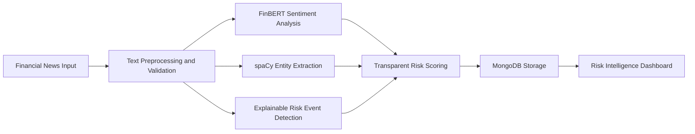

# Financial News Risk Intelligence System

A compact academic decision-support prototype that analyzes financial news with FinBERT sentiment inference, spaCy named-entity recognition, and transparent phrase-based risk event rules. It saves article analyses and potential alerts in MongoDB and presents them through a dark Streamlit dashboard.

> **Academic disclaimer:** This prototype is not a validated investment-risk model, does not verify reported claims, and is not investment advice. A detected item is a potential event indicator based on text and rules. FinBERT's scores describe text classification and are not probabilities of future financial outcomes.

## Problem and objectives

Financial news is unstructured and can be difficult to triage consistently. The application demonstrates a small, inspectable workflow for classifying article sentiment, extracting named organizations, highlighting possible risk language with sentence-level evidence, assigning a configurable score, and storing the resulting record for review.

## Core functionality

1. **Financial News Analysis:** paste one article or upload a CSV; infer positive, negative, or neutral sentiment with `ProsusAI/finbert`; extract organizations and related entities with `en_core_web_sm`; detect six categories of potential events; show evidence and a factor breakdown; persist the result.
2. **Evidence-Based Risk Intelligence:** view database-derived dashboard metrics and charts; search and filter alerts; mark alerts Reviewed or Dismissed; inspect the saved analysis.

CSV requires `title` and `text`. `source_name`, `source_url`, and `published_at` are optional. Upload is limited to 5 MB and 50 articles. Long input is bounded to 100,000 characters for entities and 20,000 characters/512 tokens for FinBERT.

## Technology and methods

| Area | Implementation |
|---|---|
| UI | Python, Streamlit, custom CSS, Plotly |
| Deep learning | PyTorch inference with pretrained Hugging Face FinBERT |
| NLP | Hugging Face Transformers and spaCy English NER |
| Data | Pandas, MongoDB, PyMongo |
| Configuration | python-dotenv |
| Tests | pytest; model output is mocked in tests |

**FinBERT** is a BERT-family model fine-tuned for financial sentiment. The application uses its actual tokenizer and model weights at inference time and maps the model's output scores to positive, negative, and neutral labels.

**spaCy NER** identifies organization entities and other selected named entities in context. An organization mention does not establish that the organization is publicly traded, and the app does not infer tickers.

**Event rules** scan article sentences for configured phrases in financial distress, misconduct allegations, regulatory/legal matters, earnings/guidance, cybersecurity, and operational disruption. Matching sentence, phrase, category, and a rule severity are retained as evidence. A local negation window excludes some straightforward denials; this is a small demonstrator, not full linguistic understanding. Rule matches remain potential events and allegations remain allegations.

**Risk score** is a configurable demonstration formula:

```text
score = 0.50 × event severity + 0.20 × negative sentiment
      + 0.15 × recency + 0.15 × evidence completeness
```

Each factor is normalized to 0–100. Severity uses the strongest matched event (1–5); negative sentiment uses the FinBERT negative score; recency decays linearly to zero at 30 days when a valid publication date exists; each event adds evidence completeness up to 100. Missing/invalid publication time contributes zero recency. With no matched event the final score is capped at 34 so negative sentiment alone cannot create a high alert. Priorities are Low 0–34, Medium 35–64, and High 65–100. These settings are not scientifically validated measures.

## Architecture



The input is validated and bounded; FinBERT returns a text sentiment classification; spaCy identifies named entities; rules match potential event phrases and retain evidence sentences; the scorer combines documented factors; MongoDB stores articles, analyses, and event alerts; dashboard views query those persisted records.

## Project structure

```text
financial-news-risk-intelligence/
├── app.py
├── analyzer.py
├── database.py
├── dashboard.py
├── requirements.txt
├── README.md
├── .env.example
├── .gitignore
├── tests/
│   └── test_core.py
└── data/
    └── sample_news.csv
```

## MongoDB

Database: `financial_news_intelligence`.

- `articles`: title, text, optional source metadata, creation timestamp.
- `analyses`: ObjectId article reference, sentiment and class scores, entities, detected events, score, priority, and analysis timestamp.
- `risk_alerts`: article reference, company (nullable when no organization is identified), event category/evidence, sentiment, score, priority, status, source/publication metadata, and creation timestamp.

The application creates indexes on analysis article references, alert status/priority/date, and company/category. Repeated identical article submissions update their analysis and do not duplicate their event alert records.

### Local MongoDB

Install and start MongoDB Community Server for your operating system, then verify that the service listens at `mongodb://localhost:27017/`. No database credentials are embedded in code.

### MongoDB Atlas

Create a free Atlas cluster, create a database user, allow the current client IP in Network Access, and copy the Python connection string. Place it in `.env` as `MONGODB_URI`; URL-encode reserved characters in a password. Atlas setup and network access are managed in MongoDB Atlas.

## Installation and setup

Python 3.10–3.12 is recommended. PyTorch installation options can vary by operating system and accelerator; use the official PyTorch selector if you need a CUDA-specific build.

### Windows PowerShell

```powershell
py -3.11 -m venv .venv
.\.venv\Scripts\Activate.ps1
python -m pip install --upgrade pip
pip install -r requirements.txt
python -m spacy download en_core_web_sm
Copy-Item .env.example .env
```

Edit `.env` if using Atlas or a non-default MongoDB database. Then run:

```powershell
streamlit run app.py
```

### macOS/Linux

```bash
python3 -m venv .venv
source .venv/bin/activate
python -m pip install --upgrade pip
pip install -r requirements.txt
python -m spacy download en_core_web_sm
cp .env.example .env
streamlit run app.py
```

The first analysis downloads FinBERT weights from Hugging Face and may take time; model files are cached for subsequent runs. CPU inference is supported. A working MongoDB service is required for saving and database-backed dashboard pages. If either model cannot load, the analyzer shows the error rather than fabricating a prediction.

## Usage

1. Start MongoDB and launch Streamlit.
2. Open **News Analyzer**, enter a title and article text, optionally add source and ISO publication time, then select **Analyze article**.
3. Review sentiment class scores, extracted organizations, event evidence, and factor contributions.
4. For multiple items, upload a CSV with `title,text,source_name,source_url,published_at` columns, then select **Analyze CSV articles**.
5. **Overview** displays metrics and charts queried from MongoDB. **Risk Intelligence** supports search, company/category/priority filters, status changes, and the full saved analysis.

The included `data/sample_news.csv` contains six clearly labelled synthetic illustrations. It is not actual news.

## Tests

```powershell
python -m pytest -q
```

or on macOS/Linux:

```bash
python -m pytest -q
```

The test suite covers mocked sentiment output structure, mock entity extraction, event matching and negation, scoring boundaries, and missing/invalid publication metadata. Tests do not download FinBERT weights. MongoDB persistence is exercised when the configured database is available; live model inference is not validated by these unit tests.

## Screenshots

Add screenshots after running the application:

- `[Overview dashboard screenshot](docs/screenshots/overview.png)`
- `[News Analyzer screenshot](docs/screenshots/analyzer.png)`
- `[Risk Intelligence screenshot](docs/screenshots/alerts.png)`

## Limitations and future work

The event detector uses a small phrase list and simple negation handling; it can miss paraphrases and misunderstand context. NER can mislabel organizations. FinBERT may be uncertain, and input truncation can omit context. Scores are illustrative and lack calibration against real outcomes. The dashboard reflects analyses saved by this app, not an external live news feed. The sample CSV is synthetic.

Possible future academic work includes evaluating rules against a labelled corpus, measuring sentiment calibration, improving context/negation handling, adding source provenance review, and testing score sensitivity. Those enhancements are outside the current implementation.

## References and attribution

- Araci, D. (2019). *FinBERT: Financial Sentiment Analysis with Pre-trained Language Models.* [arXiv:1908.10063](https://arxiv.org/abs/1908.10063).
- Hugging Face model: [`ProsusAI/finbert`](https://huggingface.co/ProsusAI/finbert). Follow the model card and license terms when redistributing or deploying.
- spaCy, [English model pipelines](https://spacy.io/models/en) (`en_core_web_sm`).
- Hugging Face Transformers, PyTorch, Streamlit, Plotly, and MongoDB/PyMongo documentation.
